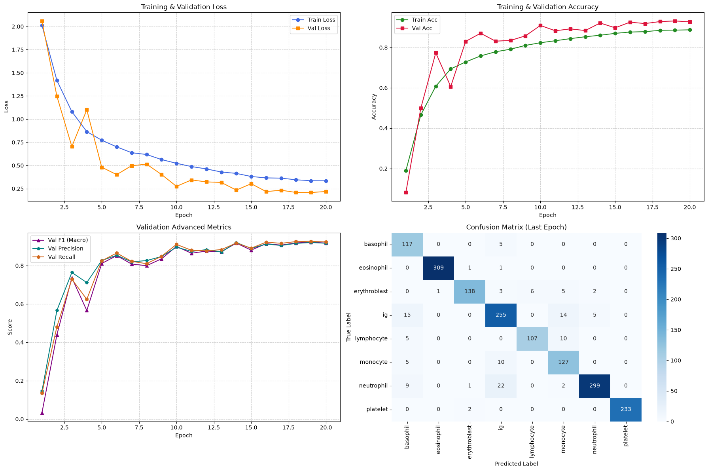

# Blood Cell Classification with Vision Transformer

A deep learning project for classifying microscopic blood cell images into eight categories using a custom Vision Transformer (ViT) implemented with PyTorch.

## Overview

This project explores the application of Vision Transformers to medical image classification. It covers dataset exploration, preprocessing, data augmentation, model implementation, training, and performance evaluation.

The model learns to distinguish between eight blood cell categories from microscopic images. To address class imbalance, class-weighted loss is used during training, and multiple metrics are reported to evaluate the model's performance.

## Dataset

The dataset contains 17,092 microscopic blood cell images belonging to eight classes.

| Class | Description |
|---|---|
| Basophil | A white blood cell involved in allergic and inflammatory responses |
| Eosinophil | A white blood cell associated with allergic responses and parasite defense |
| Erythroblast | An immature red blood cell |
| IG | Immature granulocytes |
| Lymphocyte | A white blood cell involved in adaptive immunity |
| Monocyte | A white blood cell involved in immune defense |
| Neutrophil | A white blood cell that plays an important role in fighting infections |
| Platelet | A blood component involved in clot formation |

The dataset exhibits class imbalance, which is taken into account during model training.

## Model Architecture

A custom Vision Transformer (ViT) architecture is implemented from scratch using PyTorch.

The model consists of the following components:

- **Patch Embedding:** Divides each input image into non-overlapping patches and projects them into an embedding space.
- **Class Token:** Introduces a learnable token that aggregates image-level information.
- **Positional Embeddings:** Encodes the spatial positions of image patches.
- **Transformer Encoder:** Uses multi-head self-attention and feed-forward layers to learn relationships between image patches.
- **Classification Head:** Maps the final class-token representation to the eight output classes.

### Model Configuration

| Parameter | Value |
|---|---|
| Architecture | Vision Transformer (ViT) |
| Input image size | 360 × 360 |
| Patch size | 20 × 20 |
| Embedding dimension | 128 |
| Transformer encoder layers | 4 |
| Attention heads | 4 |
| MLP hidden dimension | 256 |
| Dropout | 0.1 |
| Number of classes | 8 |

The model uses a custom architecture rather than relying on a pretrained Vision Transformer.

## Data Preprocessing and Augmentation

The preprocessing pipeline includes:

- Resizing images to 360 × 360 pixels.
- Converting images into PyTorch tensors.
- Normalizing RGB channels using dataset-specific statistics.

The training pipeline applies data augmentation to improve generalization:

- Random brightness, contrast, saturation, and hue adjustments.
- Random grayscale conversion.
- Random horizontal and vertical flips.
- Random rotations up to 30 degrees.

Validation and test images are resized and normalized without random augmentation.

## Training

The model is trained using the following configuration:

| Parameter | Value |
|---|---|
| Framework | PyTorch |
| Loss function | Class-weighted Cross-Entropy Loss |
| Optimizer | AdamW |
| Batch size | 8 |
| Training epochs | 20 |
| Learning rate scheduling | Learning rate scheduler |
| Model selection | Best checkpoint based on validation loss |

Class weights are calculated from the training-set class distribution to reduce the impact of class imbalance during optimization.

## Evaluation

The model is evaluated on a held-out test set using the following metrics:

- Accuracy
- Macro Precision
- Macro Recall
- Macro F1-score
- Confusion Matrix
- Per-class Classification Report

### Test Results

| Metric | Score |
|---|---:|
| Accuracy | 91.75% |
| Macro Precision | 90.47% |
| Macro Recall | 91.78% |
| Macro F1-score | 90.72% |

These scores are taken from the recorded test evaluation output. Actual results may vary depending on the training configuration, data split, and random initialization.

### Training Curves and Confusion Matrix

The following figure summarizes the training and validation learning curves, evaluation metrics, and classification performance.



## Repository Structure

```text
blood-cells-detection/
├── dataset/
├── dataset plots/
├── test_results/
├── training_results/
│   └── plots/
│       └── output.png
├── best_vit_model.pt
├── prepare & analyze dataset.ipynb
└── train.ipynb
```

### Files and Directories

- **`dataset/`** — Dataset files used by the project.
- **`dataset plots/`** — Visualizations created during dataset exploration.
- **`test_results/`** — Test evaluation outputs and related visualizations.
- **`training_results/`** — Training outputs, learning curves, and plots.
- **`training_results/plots/output.png`** — Combined figure containing training curves, evaluation metrics, and the confusion matrix.
- **`best_vit_model.pt`** — Saved model checkpoint.
- **`prepare & analyze dataset.ipynb`** — Notebook for dataset exploration, class distribution analysis, and data preparation.
- **`train.ipynb`** — Notebook containing model implementation, training, validation, and test evaluation.

## Installation and Usage

### 1. Clone the Repository

```bash
git clone https://github.com/a-khorasani/blood-cells-detection.git
cd blood-cells-detection
```

### 2. Create a Virtual Environment

```bash
python -m venv .venv
```

Activate the environment on Windows:

```bash
.venv\Scripts\activate
```

On Linux or macOS:

```bash
source .venv/bin/activate
```

### 3. Install Dependencies

```bash
pip install torch torchvision numpy pandas pillow matplotlib seaborn scikit-learn tqdm notebook
```

For GPU acceleration, install the appropriate PyTorch version for your hardware and CUDA environment using the official [PyTorch installation guide](https://pytorch.org/get-started/locally/).

### 4. Run the Notebooks

Start Jupyter Notebook:

```bash
jupyter notebook
```

Run the notebooks in the following order:

1. `prepare & analyze dataset.ipynb`
2. `train.ipynb`

Make sure the dataset directory, generated CSV split files, and other required files are available at the paths expected by the notebooks. Depending on your local setup, you may need to adjust the paths before running the code.

## Future Improvements

Possible directions for extending this project include:

- Comparing the custom Vision Transformer with CNN architectures such as ResNet and EfficientNet.
- Evaluating pretrained Vision Transformers using transfer learning.
- Exploring alternative methods for handling class imbalance.
- Applying explainability techniques such as Grad-CAM or attention visualization.
- Testing generalization on independent datasets.
- Developing an inference interface for classifying individual blood cell images.

## Disclaimer

This project is intended for educational and research purposes only. It is not a clinically validated diagnostic system and should not be used as a substitute for professional medical assessment.

## Author

**Amirhossein Khorasani**

GitHub: [@a-khorasani](https://github.com/a-khorasani)
